<div align="center">

# MUSTANG — Shelby GT500

**Une expérience web immersive en 3D où le scroll pilote une caméra de cinéma autour d'une Ford Mustang Shelby GT500.**

[**🏁 Voir le site en ligne**](https://pouzerguesantoine-design.github.io/mustang/)


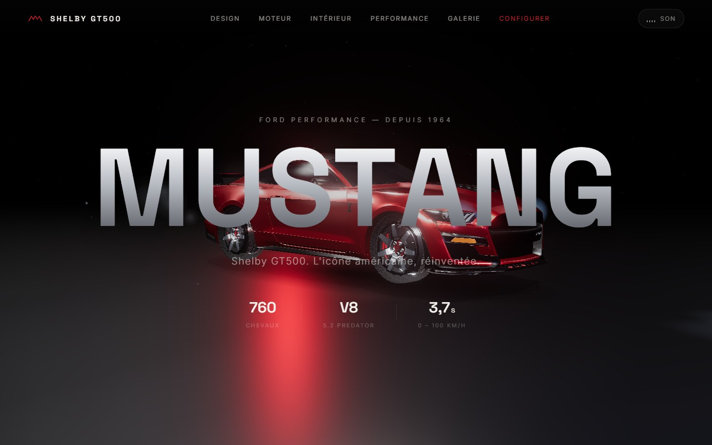

</div>

---

## Sommaire

- [Le concept](#le-concept)
- [Aperçu des 8 scènes](#aperçu-des-8-scènes)
- [Fonctionnalités](#fonctionnalités)
- [Lancer le projet en local](#lancer-le-projet-en-local)
- [Structure du projet](#structure-du-projet)
- [Technologies](#technologies)
- [Performances](#performances)
- [Documentation détaillée](#documentation-détaillée)
- [Crédits & mentions](#crédits--mentions)

---

## Le concept

On ne fait pas défiler une page : **on pilote une caméra**. Chaque mouvement de la molette fait avancer, tourner, monter ou plonger la caméra autour de la voiture, pendant que les textes, compteurs et panneaux apparaissent en parfaite synchronisation.

La direction artistique s'inspire des sites des constructeurs haut de gamme (Porsche, McLaren, Apple) : noir profond, chrome, rouge Mustang, typographie monumentale, effets de verre et lumière dynamique.

---

## Aperçu des 8 scènes

### 1 · Hero — l'apparition
La GT500 sort de l'obscurité, les phares s'allument avec un double appel, le moteur démarre et l'échappement fume.


### 2 · Design — le tour complet
La caméra fait le tour du véhicule pendant que quatre cartes mettent en valeur la peinture, les jantes, les freins et les feux.

| Peinture | Jantes | Feux tri-barre |
|:---:|:---:|:---:|
| 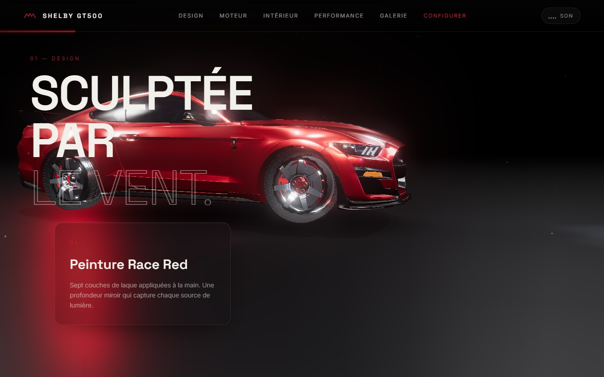 | 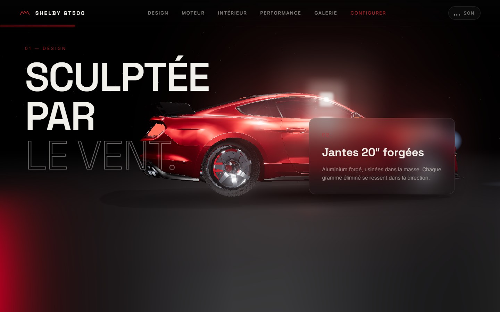 | 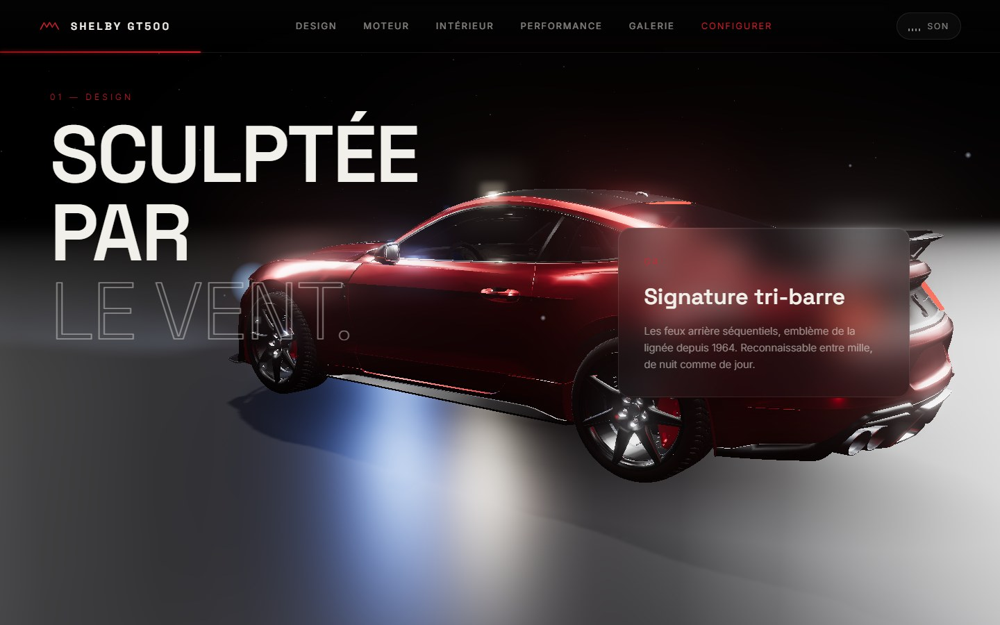 |

### 3 · Moteur — la vue éclatée
Le vrai V8 5.2 du modèle 3D (bloc, compresseur, boîte) se sépare en pièces au fil du scroll. Les chiffres clés s'animent.

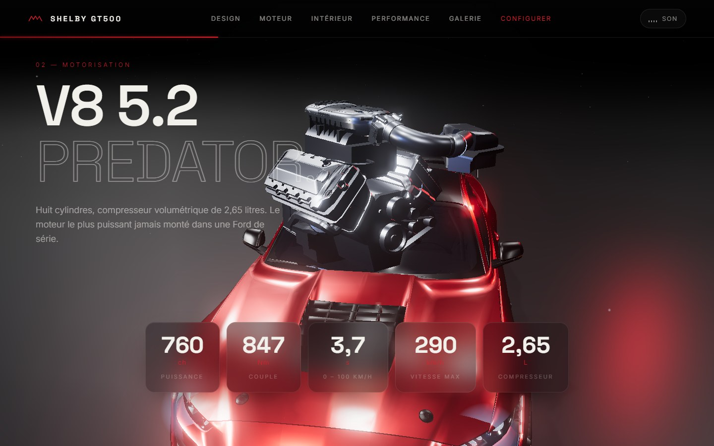

### 4 · Intérieur — le poste de conduite
La caméra entre par la vitre et s'installe au volant. Les boutons d'ambiance changent la couleur de l'habitacle en direct.

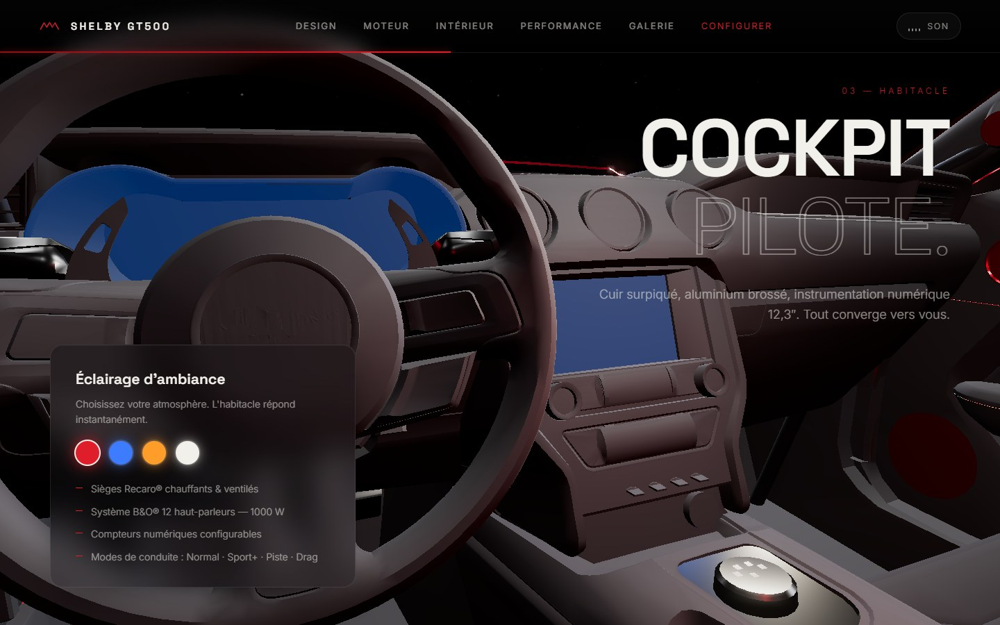

### 5 · Performance — la ligne droite
Caméra au ras du sol, compteur 0 → 290 km/h piloté par le scroll, barres comparatives et effet de vitesse.

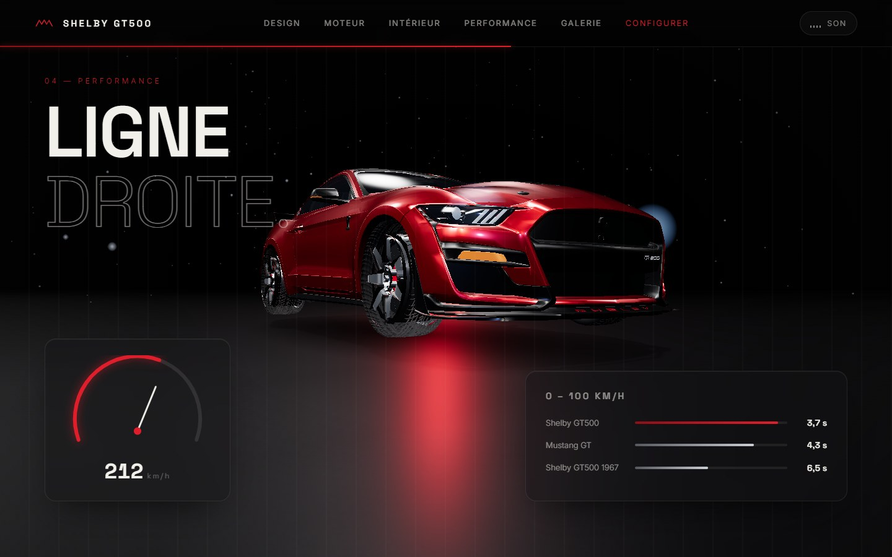

### 6 · Galerie — sous toutes les lumières
Six rendus de la voiture qui flottent en parallaxe et s'inclinent en 3D au survol de la souris.

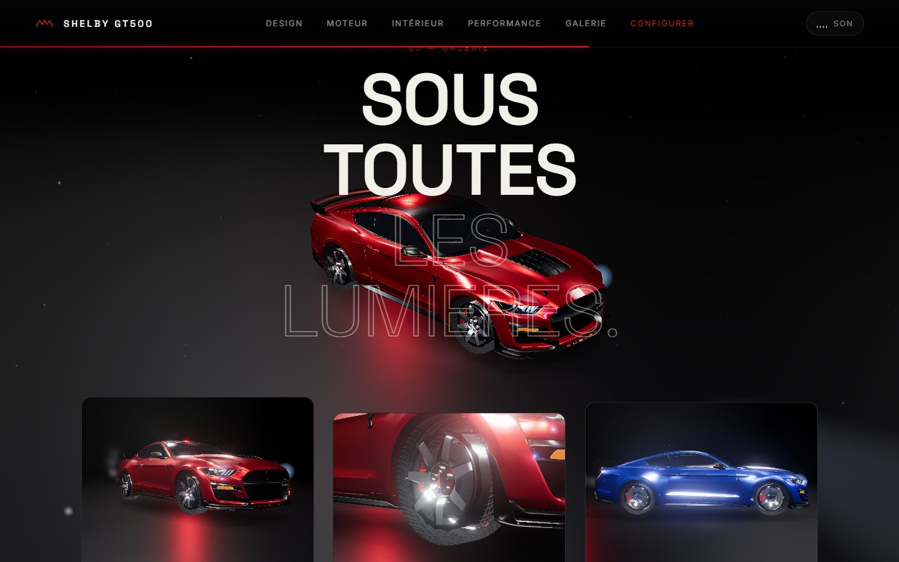

### 7 · Configurateur — la vôtre, exactement
Teinte, finition des jantes, couleur des étriers et aileron : la voiture change instantanément, le prix se recalcule.

| Configuration d'origine | Bleu Grabber, jantes noires, étriers jaunes |
|:---:|:---:|
| 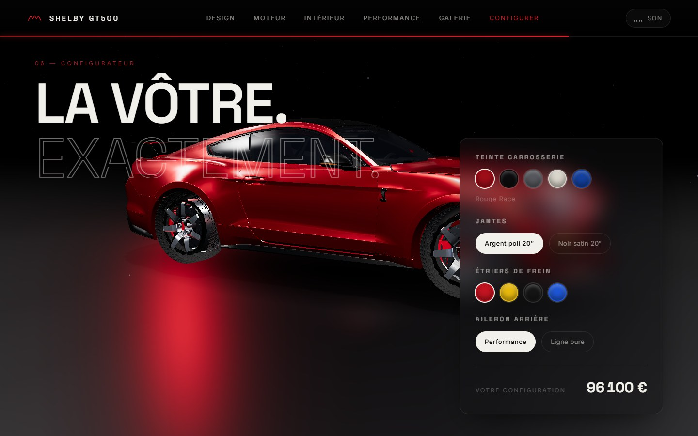 | 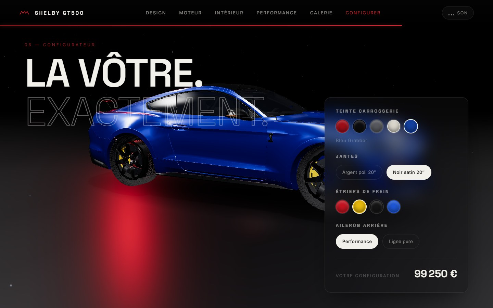 |

### 8 · Finale — le départ
La Mustang démarre, accélère et disparaît à l'horizon. La caméra reste immobile, fondu au noir, appel à l'action.

| Le départ | L'écran final |
|:---:|:---:|
| 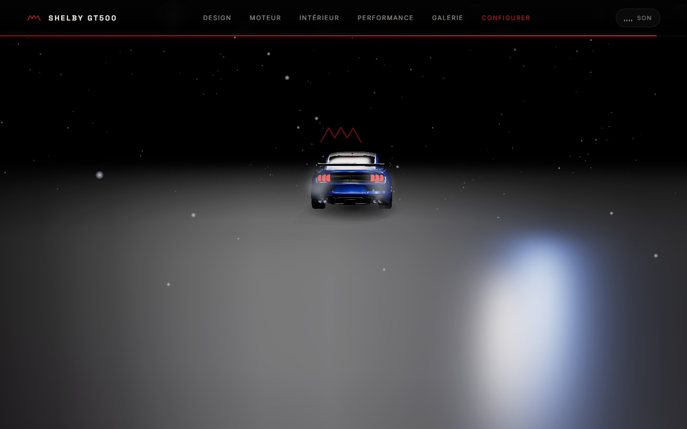 | 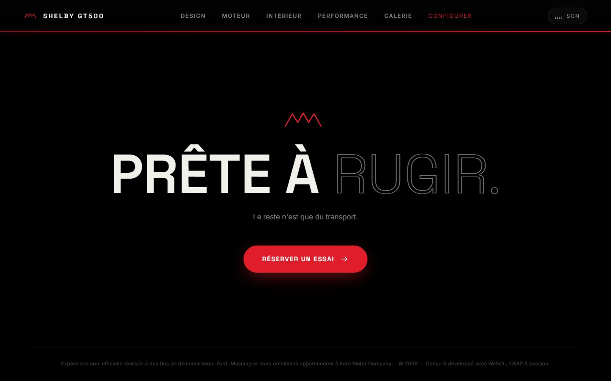 |

### Sur mobile

<p align="center">
  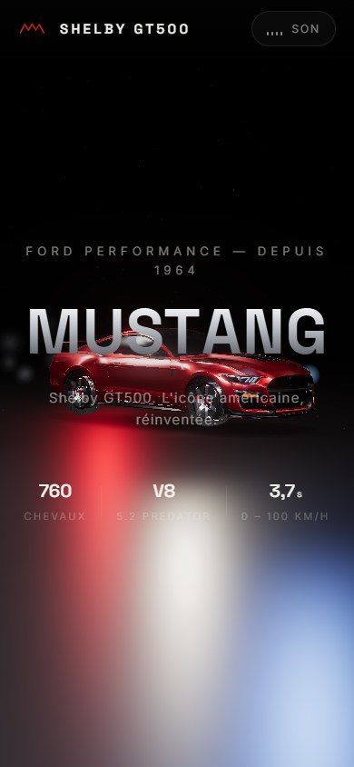
  &nbsp;&nbsp;
  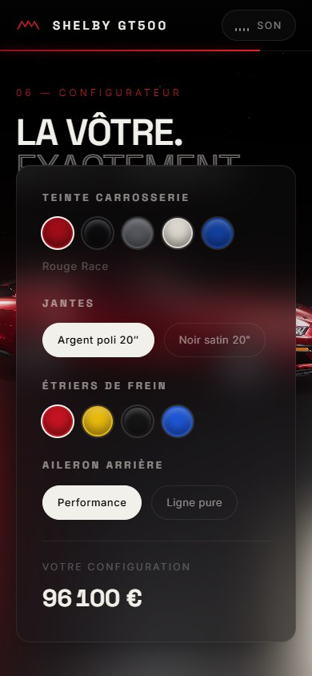
</p>

---

## Fonctionnalités

**Expérience 3D**
- Modèle Shelby GT500 haute qualité, re-matérialisé en PBR (peinture vernie *clearcoat*, verre fumé, chrome, cuir)
- Éclairage HDR, ombres douces, brouillard, bloom, tone mapping ACES
- Caméra cinématique pilotée par le scroll, avec amortissement et parallaxe à la souris
- Roues qui tournent selon la vitesse de scroll, suspension « vivante »
- Fumée d'échappement, particules 3D, effet de vitesse
- Vue éclatée du moteur construite à partir des vraies pièces du modèle

**Interface**
- Écran de chargement avec la vraie progression du téléchargement du modèle
- Curseur personnalisé, boutons magnétiques, cartes inclinables en 3D
- Navigation en verre dépoli avec indicateur de progression
- Compteurs animés, compteur de vitesse, barres de performance
- Configurateur temps réel avec calcul du prix

**Son**
- Son de V8 **synthétisé en direct** (aucun fichier audio) dont le régime suit le scroll — bouton « Son » en haut à droite

**Qualité**
- Adaptation automatique de la qualité graphique selon les performances de l'ordinateur
- Responsive : ordinateur, tablette, mobile (la caméra recule automatiquement en mode portrait)
- Accessibilité : HTML sémantique, ARIA, navigation clavier, textes alternatifs, respect de `prefers-reduced-motion`

---

## Lancer le projet en local

> ⚠️ Le site utilise des modules JavaScript : **il ne fonctionne pas en double-cliquant sur `index.html`**. Il faut un petit serveur local.

**Option 1 — Python** (inclus avec le projet)

```bash
git clone https://github.com/pouzerguesantoine-design/mustang.git
cd mustang
python serve.py
```

Puis ouvrir **http://localhost:8137**.

**Option 2 — VS Code**
Installer l'extension **Live Server** (proposée automatiquement à l'ouverture du dossier), puis clic droit sur `index.html` → *Open with Live Server*.

> Une connexion Internet est nécessaire : Three.js, GSAP, Lenis et les polices sont chargés depuis des CDN.

---

## Structure du projet

```
mustang/
├── index.html                  Les 8 scènes (textes, structure, accessibilité)
├── serve.py                    Serveur local de développement (sans cache)
├── css/
│   └── main.css                Toute la direction artistique
├── js/
│   ├── main.js                 Chef d'orchestre : scroll, animations, interactions
│   ├── config.js               Couleurs, options et prix du configurateur
│   ├── experience/             Tout ce qui est 3D
│   │   ├── Experience.js         Moteur de rendu, post-processing, qualité adaptative
│   │   ├── Car.js                Chargement et préparation de la voiture
│   │   ├── CameraDirector.js     Trajectoire de la caméra
│   │   ├── Engine.js             Vue éclatée du moteur
│   │   ├── Environment.js        Studio : sol, lumières, brouillard
│   │   ├── Particles.js          Poussière et effet de vitesse
│   │   └── Smoke.js              Fumée d'échappement
│   ├── ui/
│   │   ├── Loader.js             Écran de chargement et intro
│   │   └── Cursor.js             Curseur, boutons magnétiques, cartes 3D
│   └── audio/
│       └── EngineSound.js        Son du V8 synthétisé
├── assets/
│   ├── models/                 Modèle 3D de la Shelby GT500 (FBX)
│   └── images/                 Rendus de la galerie
└── docs/
    ├── ARCHITECTURE.md         Fonctionnement technique détaillé
    ├── GUIDE-MODIFICATION.md   Comment modifier le site pas à pas
    └── screenshots/            Captures d'écran de ce README
```

---

## Technologies

| Rôle | Outil |
|---|---|
| Rendu 3D, matériaux PBR | [Three.js](https://threejs.org/) r160 |
| Chargement du modèle | `FBXLoader` |
| Post-processing | `UnrealBloomPass`, `OutputPass` |
| Éclairage d'environnement | `RoomEnvironment` + `PMREMGenerator` |
| Animations | [GSAP](https://gsap.com/) 3.12 + ScrollTrigger |
| Scroll fluide | [Lenis](https://lenis.darkroom.engineering/) |
| Son | Web Audio API (synthèse) |
| Typographie | Space Grotesk & Inter (Google Fonts) |

Aucun *framework* ni étape de compilation : du HTML, du CSS et du JavaScript moderne, directement lisibles et modifiables.

---

## Performances

Le modèle 3D d'origine, une fois chargé, générait **près de 4 500 appels de dessin par image** (le site tournait à ~13 images/seconde). Toute la géométrie fixe est désormais **fusionnée par matériau** au chargement : **~130 appels de dessin**, soit **~12 ms par image** sur une puce graphique intégrée Intel Iris Xe — au-delà des 60 images/seconde.

Si l'ordinateur reste trop lent, le site réduit lui-même sa qualité (bloom puis post-processing désactivés).

---

## Documentation détaillée

- 📐 [**Architecture technique**](docs/ARCHITECTURE.md) — comment les modules communiquent, la caméra, la fusion de géométrie, la boucle de rendu
- 🛠️ [**Guide de modification**](docs/GUIDE-MODIFICATION.md) — changer un texte, une couleur, un prix, la trajectoire de la caméra, ou remplacer la voiture
- 🚗 [**Le modèle 3D**](assets/models/README.md) — provenance, structure, pièces utilisées

---

## Crédits & mentions

- **Modèle 3D** : Ford Mustang Shelby GT500, modèle téléchargé depuis Sketchfab. Voir [assets/models/README.md](assets/models/README.md) pour la licence et l'attribution de l'auteur.
- Ford, Mustang, Shelby et leurs logos sont des marques de leurs propriétaires respectifs. **Ce site est un projet personnel et non officiel**, réalisé à des fins de démonstration et de portfolio. Les caractéristiques et prix affichés sont indicatifs.
